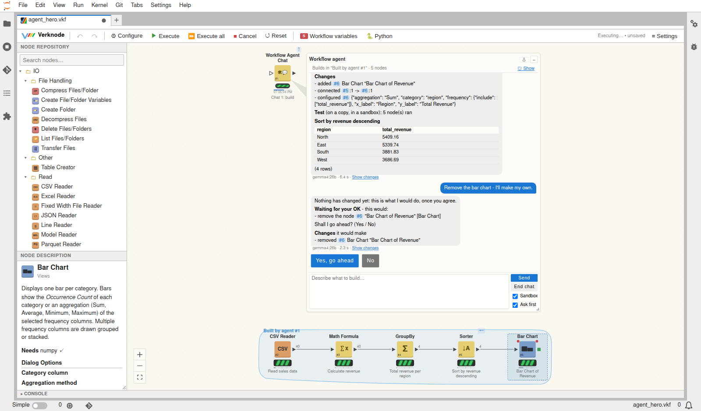
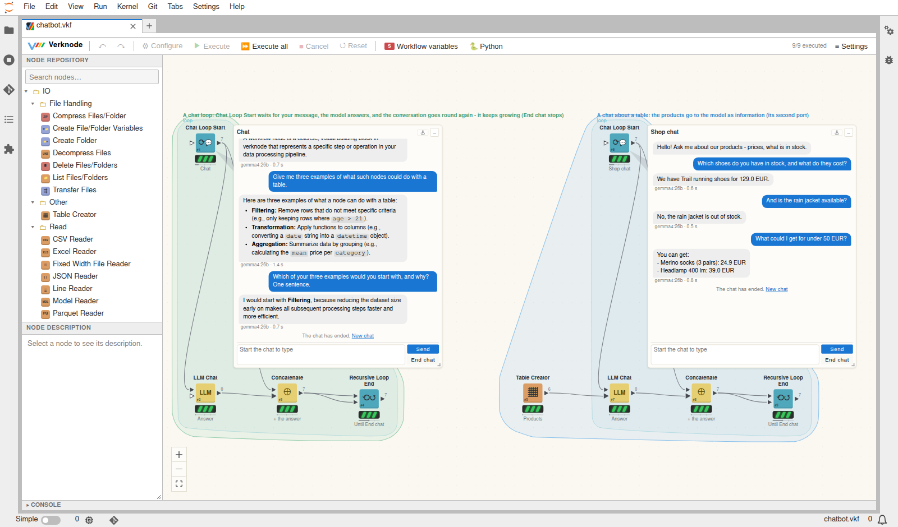
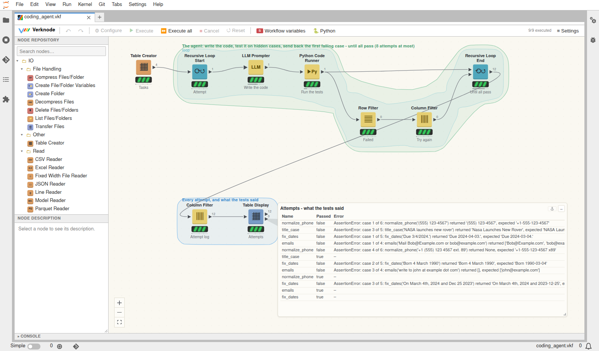

  <picture>
    <source media="(prefers-color-scheme: dark)" srcset="docs/assets/verknode_banner_dark-v2.png">
    
  </picture>

  <b>Visual, node-based data workflows for Python, inside JupyterLab.</b>

Build data pipelines by connecting nodes on a canvas: read files, clean and
reshape tables, run statistics and machine learning, draw charts, work with
molecules - and see every intermediate result. Tables flow between nodes as
[polars](https://pola.rs) DataFrames, workflows are saved with their data,
and everything stays scriptable from Python.

You can also build a workflow by chatting with an agent on the canvas, or let
your own agents build and run workflows over MCP. Any workflow exports as a
standalone Python script that runs without Jupyter.

## Highlights

- **About 250 nodes** for files, tables, dates, JSON / XML, statistics,
  scikit-learn models, databases, charts, loops, switches and error
  handling ([nodes](docs/nodes.md)).
- **Widgets on the canvas** - sliders, inputs and editable tables next to
  their nodes; tables and charts that update as you change them, and whose
  selections feed the rest of the workflow ([widgets](docs/widgets.md)).
- **See it run** - status lights, time bars with estimates, progress and the
  expected end of every node, loop iteration counters
  ([editor](docs/editor.md)).
- **Python all the way** - write nodes as Python classes, run notebooks as
  nodes, drive an open workflow from a notebook, export a workflow as a
  script - also a standalone one that runs without Jupyter, from a terminal,
  cron or CI ([custom nodes](docs/custom-nodes.md),
  [Python API](docs/python-api.md#standalone-scripts-workflows-without-jupyter)).
- **Export anywhere** - a workflow (or one group of it) as a folder that
  runs on its own. Its requirements.txt holds only what it needs, measured
  by running it: a workflow of table nodes needs only polars. Headless
  exports drop the widgets and turn input widgets into parameters, and a
  Dockerfile and an HTTP API server can come with it ([export](docs/export.md)).
- **An agent that builds the workflow with you** - describe what you need
  in a chat on the canvas. The agent finds node types, adds, configures and
  connects nodes, and tests them on a copy in a file sandbox before anything
  changes. It works only in its own group and asks before removing anything
  ([workflow agent](docs/llm.md#a-workflow-agent-build-the-workflow-in-a-chat)).
- **For your agents, too** - an MCP server (stdio, or live inside JupyterLab)
  lets Claude Code, Claude Desktop or any LLM build, run and read workflows:
  pipelines you can open and check rather than throwaway scripts, and
  reviewed workflows that agents run as tools with other parameters
  ([agents](docs/agents.md)).
- **LLMs in the workflow** - prompt a local Ollama or any OpenAI-compatible
  server for every row: classify, summarize, extract typed fields; a chat
  that answers questions about the workflow's results, computing its numbers
  with SQL; summaries of tables by a prompt; a chatbot on the canvas; a small coding agent that writes code until hidden tests
  pass; manage Ollama's models and GPU memory ([LLM nodes](docs/llm.md)).
- **Chemistry built in** - RDKit molecules as a column type, drawn as
  structures, with a structure sketcher; proteins and ligands in 3D with
  NGL or Mol*, in node views and on the canvas ([chemistry](docs/chemistry.md)).

## A quick look

**Build workflows** from the node repository, with loops, switches and
groups outlined on the canvas:

**Widgets on the canvas**: sliders and inputs next to their nodes, and
charts that update as you change them; clicking a bar selects its rows for
the rest of the workflow:

**Watch them run**: every node shows its run time, progress and when it
should be done; loops count their iterations:

**Look at any result**, including molecules drawn as structures:

**Molecules in 2D and 3D**: pick ligand poses in a table of structures and
see them in the protein pocket (Mol*), or let RDKit generate 3D structures
from SMILES (NGL):

**Build a workflow by chatting with an agent**: tell the Workflow Agent Chat
what you need ("total revenue per region, largest first", "as a bar chart").
For each message the model works with tools:
- it looks up node types and their settings;
- it adds, configures and connects nodes;
- it runs and previews them on a copy of the workflow, in a file sandbox,
  and fixes what fails.

Then the nodes appear in the agent's own group. Each reply lists the
changes and the first rows of the result. **Show changes** highlights them
on the canvas, and Tab adds the nodes you selected to your message.
Anything that undoes earlier work, like removing a node, waits for your
*Yes*. A finished chat can be resumed, or carried on in a second agent node
that takes the conversation as input:

**Chat with a model** right on the canvas: a Chat Loop Start waits for your
message, a local LLM answers (here with Ollama), and the conversation goes
round the loop again - it keeps growing, and answers can come from your
tables:

**Let a model write code** until hidden tests pass: a small coding agent made
of ordinary nodes - the model writes the code, the Python Code Runner tests
it, and each failing case goes back to the model:

## Quick start

With Docker:

    git clone https://github.com/verknode-project/verknode.git
    cd verknode/docker
    make build      # creates docker/credentials_norepo.env - set JUPYTER_TOKEN there
    make up         # http://127.0.0.1:8888/lab?token=<JUPYTER_TOKEN>

Open `notebooks/examples/demo.vkf` (more examples next to it:
`widgets.vkf`, `timing.vkf`, `analytics.vkf`, `chemistry.vkf`,
`structures.vkf`, `llm.vkf`, `ollama.vkf`, `coding_agent.vkf`, `time_loops.vkf`, `chatbot.vkf`, `workflow_agent.vkf`, `data_chat.vkf`, `custom_nodes.vkf`), or create a workflow from the Launcher.

Other setups (network, reverse proxy, without Docker):
[deployment](docs/deployment.md).

## Documentation

See [docs/](docs/README.md): the [editor](docs/editor.md),
[nodes](docs/nodes.md), [widgets](docs/widgets.md),
[custom nodes](docs/custom-nodes.md), [Python API](docs/python-api.md),
[export](docs/export.md), [agents and MCP](docs/agents.md),
[chemistry](docs/chemistry.md), [deployment](docs/deployment.md) and
[development](docs/development.md).

## License

verknode is licensed under the [Apache License 2.0](LICENSE).
