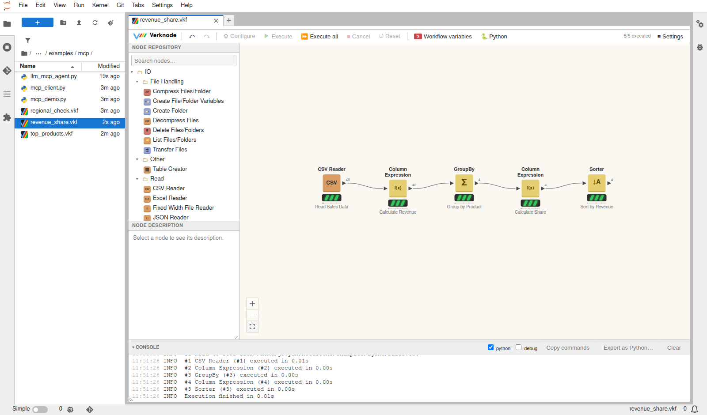

# Agents: the verknode API and MCP server

Agents can create, change, run and read verknode workflows with a small set
of tools. MCP clients (Claude Code, Claude Desktop, IDEs, agent frameworks)
reach them through the verknode MCP server. Other programs and LLMs use the
same tools from Python.

## Why let an agent build a workflow

When you ask an agent a data question, it usually writes a throwaway script,
runs it and reports a number. If instead it builds a verknode workflow, you
get more than the answer:

- **It can be checked.** The workflow opens in JupyterLab, and every step is
  a node you can look at: its settings, the rows going in and coming out.
  You can follow the reasoning rather than trust it.
- **It stays.** The `.vkf` file runs again next month and changes like any
  workflow: move a node, add a filter, swap the data.
- **It becomes a tool.** A workflow takes workflow variables, such as a
  threshold or a date. `run_workflow` runs it on a private copy with other
  values, so a reviewed workflow answers the same question again, for anyone
  and for any agent, without being rebuilt.
- **It uses tested parts.** The agent mostly configures and connects nodes,
  such as joins, group-bys and pivots, rather than writing code. Each tool
  result shows the node's output columns, or why it is not ready.
- **You can watch it build.** Over the live endpoint, the agent's edits
  appear in the open editor as it makes them, and you can step in.

## Connecting

**Headless (stdio).** The server works on `.vkf` files in a folder and
needs no JupyterLab. Edits are saved as they are made (`--no-autosave`
turns that off).

    python -m jupyterlab_verknode.mcp_server --root ~/notebooks

    # Claude Code
    claude mcp add verknode -- python -m jupyterlab_verknode.mcp_server --root ~/notebooks
    # in the Docker setup: the server runs in the container
    claude mcp add verknode -- docker compose -f docker/compose.yml exec -T verknode \
        python -m jupyterlab_verknode.mcp_server --root /home/jovyan/notebooks

Claude Desktop (`claude_desktop_config.json`):

    {"mcpServers": {"verknode": {"command": "python",
      "args": ["-m", "jupyterlab_verknode.mcp_server", "--root", "/path/to/notebooks"]}}}

**Live (HTTP, inside JupyterLab).** The Jupyter server serves MCP at
`/verknode/mcp`. The agent works on the open workflows:
- its edits appear in the editors at once, and yours reach the agent;
- runs happen on the server;
- `save_workflow` saves, as the editor's Save does.

Requests need the Jupyter token.

    claude mcp add --transport http verknode http://localhost:8888/verknode/mcp \
        --header "Authorization: token $JUPYTER_TOKEN"

Workflow paths are relative to the workspace: the `--root` folder, or the
Jupyter server's root.

## Tools

| Tool | |
|---|---|
| `list_workflows`, `list_files` | the workflows and data files; with a workflow, `list_files` gives paths as its settings take them |
| `find_node_types`, `node_type_help` | search the ~300 node types; ports, settings, setting formats and defaults |
| `create_workflow`, `show_workflow` | make a workflow; its nodes with settings, output columns, problems, connections, groups and variables |
| `add_node`, `configure_node`, `connect`, `disconnect`, `remove_node`, `undo` | edit it; each result shows the node's output columns or why it is not ready |
| `set_variables` | workflow variables; settings can be taken from them (`variables: {setting: name}`) |
| `run` | run all or some nodes: each node's state, rows and time, and the problems (`sandbox`: on a copy, nothing written) |
| `get_table` | rows of an output table, as Markdown, JSON or CSV, a page at a time |
| `run_workflow` | a workflow as a tool: a private copy, run with other variable values, its result tables |
| `export_workflow` | export to run without Jupyter: a script, or a self-contained folder (minimal requirements, data, Dockerfile, API server; a group; headless) - see [Export](export.md) |
| `save_workflow` | save, or save as |

The results are written for models:
- Node types can be given by name. A misspelled name gets the closest
  matches.
- A setting the node does not have gets the list of its settings.
- A path to a file that is not there gets the matching file's path
  relative to the workflow.
- A node that is not ready says why, including the node further up that
  holds it back.

Every result also has the data as `structuredContent`. The tools carry MCP
hints: the read-only ones are marked so, and `remove_node`, `disconnect` and
`create_workflow` (it can overwrite) are marked destructive, so clients can
ask before using them.

**Safety:**
- Paths outside the workspace are refused.
- The live endpoint uses the Jupyter server's authentication.
- `run` and `run_workflow` with `sandbox: true` run in the file sandbox of
  the [workflow agent](llm.md#a-workflow-agent-build-the-workflow-in-a-chat).
  Files are copied in when they are used, and what the run would write is
  reported, not written.
- Scripts and custom nodes do not run in the sandbox.

## From Python, with any LLM

    from jupyterlab_verknode.agentapi import AgentAPI, LocalWorkspace

    api = AgentAPI(LocalWorkspace("notebooks"))
    out = await api.call("find_node_types", {"query": "pivot"})   # {"text", "data", "error"}
    api.openai_tools()      # the tools as function specs for OpenAI-compatible APIs and Ollama

## A use case: "Which regions are below target?"

The question comes up every month, with different thresholds.
`notebooks/examples/agents/mcp/mcp_demo.py` plays the agent's side as plain MCP
calls:

    python notebooks/examples/agents/mcp/mcp_demo.py

1. **The agent looks around.** It calls `list_files`, then
   `find_node_types("join two tables")`, then `node_type_help` for the
   types it will use.
2. **It builds `mcp/regional_check.vkf`:**
   - read the sales and compute revenue (`amount * quantity`);
   - group by region and join the regions' targets;
   - compute `% of target`;
   - keep the rows below the workflow variable `threshold`, which the Row
     Filter's value is bound to.
3. **It checks.** It calls `run`, then `get_table` on `% of target`
   (North 180.3, South 155.3, East 267, West 131.7) and on
   `Below threshold`, then `save_workflow`. You can open the workflow in
   JupyterLab, look at each step, and change it.
4. **Anyone uses it as a tool.**
   - `run_workflow(threshold=150)` gives West.
   - `run_workflow(threshold=250)` gives North, South and West.

   The saved workflow stays as it was.

`notebooks/examples/agents/mcp/llm_mcp_agent.py` lets a model do the agent's part.
It gives the server's tools to the model you set up for the
[LLM nodes](llm.md#the-server) (`VERKNODE_LLM_URL`, `VERKNODE_LLM_MODEL`)
and asks a question:

    python notebooks/examples/agents/mcp/llm_mcp_agent.py "Which product sold the most units in each region?"
    python notebooks/examples/agents/mcp/llm_mcp_agent.py --http http://localhost:8888/verknode/mcp \
        --workflow notebooks/examples/agents/mcp/revenue_share.vkf \
        "Revenue per product, largest first, and its share of the total in percent? Data: notebooks/examples/agents/data/sales.csv"

**Run with gemma4:26b on Ollama.** The model found the node types and
corrected a file path from the tool's hint. It then built and checked:
- for the first question, a reader, GroupBy, Rank within region and Row
  Filter, giving Headlamp in North and East, Socks in South, and Shoes and
  Jacket tied in West;
- for the second, `revenue_share.vkf`, live in the open editor, giving
  Headlamp 35.86 %, Shoes 24.53 %, Socks 20.36 % and Jacket 19.24 %.

Both answers matched a direct computation, and each took 20 to 40 seconds.

What helps models here:
- **Errors that say what to write.** For example, a formula error says that
  columns are written `$name$`, with an example from the table's own
  columns. An earlier run failed for want of this: the model kept writing
  `$amount * $quantity`, and the errors only said "Unexpected input".
- **Clean-up instructions.** The server's instructions ask the model to
  fix or remove failing and unconnected nodes.
- **Numbering from 1.** A workflow replaced by `create_workflow` numbers
  its nodes from 1 again.

