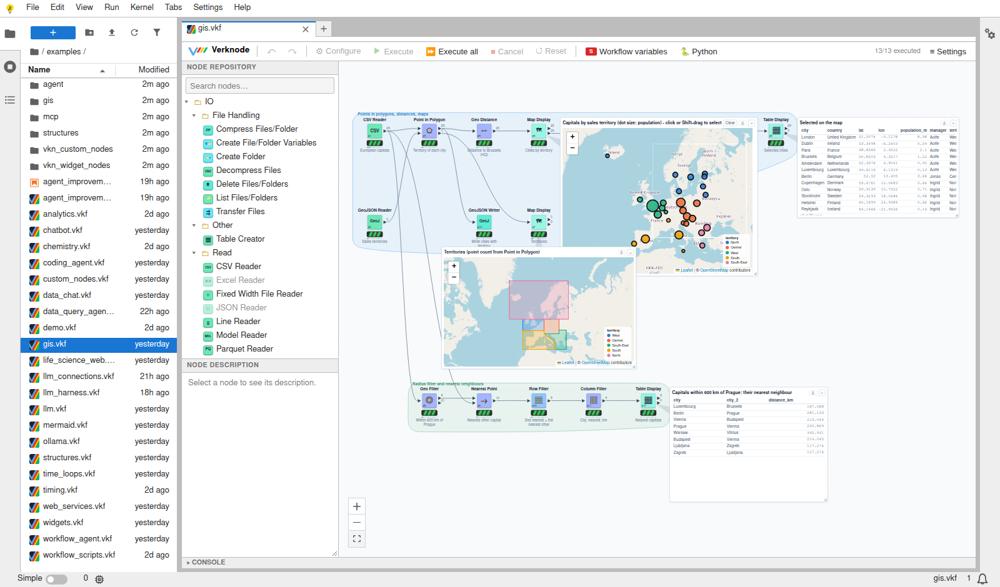

# verknode in the browser (JupyterLite)

verknode also runs as a JupyterLite site: JupyterLab and the workflow
editor as static files, with no server and no installation.
- **The engine** runs in the page, in a Pyodide kernel (Python compiled to
  WebAssembly).
- **Your files** are stored in the browser.

Put the site on any static host (GitHub Pages, a web server, a USB stick
with `python3 -m http.server`), and anyone with a browser can open and run
workflows.

## Building and opening it

From `docker/`:

    make lite          # builds the site into lite/_output (Docker; a few minutes the first time)
    make lite-serve    # serves it at http://localhost:8000

Open `http://localhost:8000/lab/index.html`, and a workflow in `examples/`.

- **The first start** takes 20 to 40 seconds. The browser loads Pyodide and
  the Python packages (numpy, polars, pyarrow, about 40 MB) from Pyodide's
  CDN, and caches them for later visits.
- **Hosting** needs no server-side code. The host must serve `.wasm` files
  with their MIME type, and the page must be on HTTPS or `localhost`: the
  service worker that lets the kernel read the browser's files requires it.

The build (`docker/lite/Dockerfile`) has two stages:
1. It makes verknode's wheel, as the pip image does.
2. It builds the site with jupyterlite-core 0.6.4 and
   jupyterlite-pyodide-kernel 0.6.1. That kernel brings Pyodide 0.27, the
   last Pyodide with polars (1.18). The examples
   (`notebooks/examples`) become the site's files.

## How it works

The editor talks to the workflow engine through one REST API, the same as
with the Jupyter server. In JupyterLite there is no server. Instead:

1. **The calls go to a kernel.** The editor (`src/lite.ts`) starts a Pyodide
   kernel of its own, installs numpy, polars and pyarrow from Pyodide and
   verknode's wheel, and sends each call to a bridge there
   (`jupyterlab_verknode/lite.py`). The bridge does what the server's
   handlers do, on the browser's files (`/drive` in the kernel).
2. **There are no threads in the browser.** A run executes before its call
   returns, so the canvas shows the result when the run is done, not while
   it runs. Thread pools run one task after another.
3. **Packages load on demand.** Before a run, the bridge loads what its
   nodes need from Pyodide's packages, such as scikit-learn, scipy, pandas
   or matplotlib. A run that still misses a module loads it and runs the
   failed nodes once more.
4. **Some polars and pyarrow behaviour is patched.** Pyodide's polars 1.18
   can't read files by path from the browser's drive, and it panics in
   `to_arrow`. So in the browser, files go through Python's own file I/O,
   and Parquet (saved workflows, the Parquet nodes) goes through pyarrow.
   `engine/compat.py` also covers the API differences between polars 1.18
   and 2.
5. **HTTP goes through the browser** (pyodide-http). Web services and LLM
   servers must allow the page's origin (CORS).

## What works, and what does not

| | In the browser |
|---|---|
| The editor, groups, metanodes, undo, copy and paste, the Python console view | yes |
| Tables, rows, columns, joins, GroupBy, pivots, formulas, rules, loops, switches, flow variables, Python Script | yes |
| Canvas widgets: inputs, tables, charts, value and gauge displays, Map Display, Mermaid, Text Display | yes |
| Hover inspection, port and node views | yes |
| Saving, and opening again later | yes, in this browser's storage |
| Analytics / Mining / Statistics (scikit-learn, scipy, statsmodels) | yes, loaded on the first run |
| Static charts (matplotlib) | yes, loaded on the first run |
| GIS nodes | yes |
| Web services | those that allow other origins (CORS): Wikipedia, GitHub, OpenStreetMap Geocode, Open-Meteo, Apple Podcasts; not the Overpass server, nor feeds without CORS |
| LLM nodes | with an `llm.env` file (below), and a server that allows the page's origin |
| Chats on the canvas: LLM chat loops, Data Q&A Chat, Workflow Agent Chat | no: a run in the browser cannot wait for messages, so they stop with a message |
| RDKit nodes, the Molecule Sketcher | no: RDKit and Ketcher are not in Pyodide |
| SQLite database nodes on files | no: SQLite cannot work on the browser's files |
| Python Code Runner, the Jupyter Notebook node, export folders | no: they need processes |
| The MCP server and agent API | no: they are server endpoints |
| Showing progress while a run is going, Cancel | no: the editor hears back when the run is done |

Nodes whose packages Pyodide lacks, such as the Excel Reader (fastexcel), are
dimmed in the Node Repository, as in a server install without them.

## Your files

The site's files are copies of the examples. What you save is kept in this
browser's storage for this site's address: IndexedDB, through
JupyterLite's contents. Keep in mind:
- **Your work stays with this browser.** It doesn't go to another browser
  or computer.
- **Clearing the site's data deletes it.** So does browsing in a private
  window.
- **To keep a workflow,** download it from the file browser (right-click ›
  Download). Upload files the same way.

**LLM settings:** create `llm.env` at the top of the file browser (or in
`.verknode/llm.env`) with `KEY=VALUE` lines:

    VERKNODE_LLM_URL=http://localhost:11434
    VERKNODE_LLM_MODEL=gemma4:26b

The server must accept requests from the page's origin. For Ollama, set
`OLLAMA_ORIGINS` to the site's address (`localhost` and `127.0.0.1` are
allowed by default). An API key in this file is stored in the browser:
use the browser version with keys only on a computer you trust.

## In a test run

| Example | In the browser |
|---|---|
| `demo.vkf` | all 15 nodes; opens in about 20 s on the first visit, then runs in 0.2 s |
| `gis.vkf` | all 13 nodes, with the Leaflet map |
| `mermaid.vkf` | all 12 nodes |
| `widgets.vkf` | 30 of 33: everything but the molecule input (RDKit) and what depends on it; matplotlib loads on the first run |
| `web_services.vkf` | 15 of 20: Overpass and a podcast feed don't allow other origins |
| `analytics.vkf` | runs, scikit-learn loaded; the database writer fails (SQLite) |
| `data_chat.vkf` | the LLM Summarizer runs with the Ollama of `llm.env`; the Data Q&A Chat stops (it waits for messages) |

Saving and reopening `gis.vkf` kept its results (13 of 13 executed, the
map's 34 markers).
