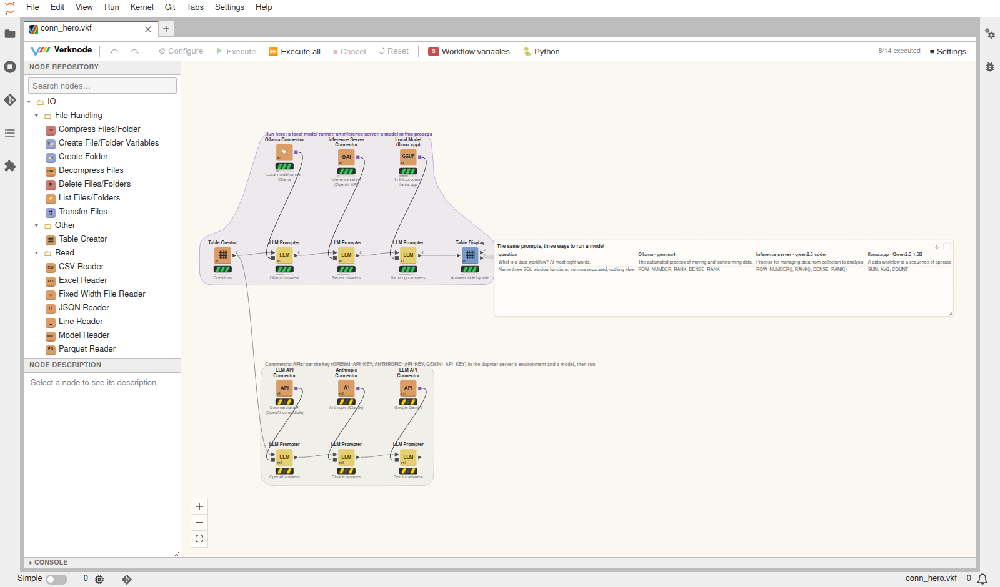

# LLM nodes

**LLM Prompter** (AI › LLM) sends a prompt to a large language model for
every row of a table and adds the answers as columns. It works with
[Ollama](https://ollama.com) and with any OpenAI-compatible server
(llama.cpp's `llama-server`, vLLM, LM Studio, OpenAI and the like).

## The prompt

The prompt is a template: `{Column}` is replaced by the row's value
(`{{` and `}}` for literal braces). An optional system prompt gives
instructions for every request. Without an input table the prompt is sent
once and the answer is a one-row table.

    System:  Classify the sentiment of a product review as positive,
             negative or mixed, with a score from -1 to 1.
    Prompt:  Review: {Review}

**Answer** is either *Text* (one column) or *JSON fields*: name the fields,
each optionally typed - `sentiment, score:number` gives a String column
`sentiment` and a Float column `score` (types: string, number, integer,
boolean). The model is held to that shape where the server supports it
(Ollama's structured outputs, llama.cpp); otherwise the first JSON object of
the answer is used.

Other settings: requests at a time (Ollama serves several at once with
`OLLAMA_NUM_PARALLEL`), a row limit (100 by default, against sending a big
table by mistake), what to do when a request fails (fail the node, or a
missing answer and an `LLM error` column), time and token columns,
temperature, the longest answer, a seed, and whether reasoning models may
think before answering (off by default: faster, and only the answer comes
back).

Answers depend on the model and can be wrong: check them before you rely
on them. The example below does this for chemical structures.

## The server

Each node can name its server URL and model; empty settings use these
environment variables of the Jupyter server:

| Variable | Meaning | Default |
|---|---|---|
| `VERKNODE_LLM_URL` | server URL | `http://localhost:11434` |
| `VERKNODE_LLM_MODEL` | model, e.g. `llama3.2`, `qwen3:8b` | - |
| `VERKNODE_LLM_PROVIDER` | `ollama` or `openai` (OpenAI-compatible) | `ollama` |
| `VERKNODE_LLM_API_KEY` | key sent as a Bearer token, if the server needs one | - |

A variable that is not set in the environment is read from
`~/.config/verknode/llm.env` (the Jupyter server's user; `KEY=VALUE` lines;
another file: `VERKNODE_LLM_CONFIG`) - handy for a server that is already
running: the file is read each time a node runs.

The configure dialog lists the models of the server. API keys are read
from an environment variable (the node names which one) and are never
stored in the workflow - put them in `docker/credentials_norepo.env`.

With Docker, set the variables in `docker/.env` (gitignored), for example:

    # Ollama on the Docker host
    VERKNODE_LLM_URL=http://host.docker.internal:11434
    VERKNODE_LLM_MODEL=llama3.2

    # Ollama as a container on a network shared with verknode
    # (join the network in compose.override.yml): its service name
    VERKNODE_LLM_URL=http://ollama:11434

    # an OpenAI-compatible server
    VERKNODE_LLM_PROVIDER=openai
    VERKNODE_LLM_URL=http://llama-server:8080
    VERKNODE_LLM_MODEL=my-model

then `make up` (the container is created again with them). An Ollama on the
Docker host must listen on more than localhost (`OLLAMA_HOST=0.0.0.0`).

## Model connections: the LLM port

Instead of the server settings above, an LLM node can take its model from
an **LLM connector** node (AI › LLM › Connect). The connector's purple
square port goes to the LLM port of LLM Prompter, LLM Chat, LLM Summarizer,
Data Q&A Chat, the workflow agents, the agent nodes and the evaluation
nodes. One connector then serves many nodes, and switching models means
switching one connection.

| Connector | For | Key |
|---|---|---|
| **Ollama Connector** | Ollama, the local model runner, on this machine or a server | - (or a variable, behind a proxy) |
| **Inference Server Connector** | OpenAI-compatible servers and engines: vLLM, SGLang, llama.cpp's llama-server, LM Studio, Hugging Face TGI, LocalAI, llamafile, Jan, Ollama's OpenAI API | if the server wants one |
| **LLM API Connector** | OpenAI, Google Gemini, Mistral, Groq, OpenRouter, Together AI, DeepSeek, xAI, Fireworks | `OPENAI_API_KEY`, `GEMINI_API_KEY`, ... |
| **Anthropic Connector** | Claude, through Anthropic's Messages API (with tool use) | `ANTHROPIC_API_KEY` |
| **Local Model (llama.cpp)** | a GGUF model run in the Jupyter server's process (llama-cpp-python), downloaded from Hugging Face if wanted | - |

- **Keys** are never stored. A connection names the environment variable
  (or the `~/.config/verknode/llm.env` setting) that holds the key, and the
  key is read when a model is called.
- **Checks:** when a connector runs, it asks the server for its models. A
  wrong address, key or model fails there, not in the nodes after it.
- **Temperature:** a connector can set one for all its nodes. That makes
  "gemma at temperature 0.8" an arm of its own in a model comparison.
- **The server's own address:** with an empty URL, the Ollama connectors
  use `VERKNODE_LLM_URL`. It is read when a model is called, so a saved
  workflow does not contain the address.
- **Local models:** the llama.cpp connector needs `pip install
  llama-cpp-python`. Its models stay loaded while the server runs and serve
  one request at a time. Tool calls work through JSON output constrained by
  a grammar, so the agents run on small local models too. Example: the
  default, Qwen2.5-1.5B (1 GB), answers in a few seconds on a CPU.

`notebooks/examples/llm_connections.vkf` sends the same prompts three ways:
- Ollama;
- an inference server (Ollama's OpenAI API stands in for vLLM and the like);
- a model in this process.

It also has the commercial APIs ready to run once their keys are set.

## Managing Ollama

The nodes in AI › Ollama look after an Ollama server (the same server
settings: a URL on the node, else `VERKNODE_LLM_URL`):

- **Ollama Models** - the models on the server: family, parameters,
  quantization, size, when they changed, whether they are loaded; with
  *Details* also their capabilities (completion, vision, tools, thinking,
  embedding) and context length.
- **Ollama Running Models** - the loaded models: size in memory, how much is
  in GPU memory (VRAM) and how much in CPU memory, the share on the GPU, the
  context length and when they unload. Pushes `ollama_gpu_memory_gb`,
  `ollama_cpu_memory_gb` and `ollama_loaded_models`. (Ollama reports the
  memory of its models, not the use of the GPU as a whole.)
- **Ollama Model Info** - per model: capabilities, context and embedding
  length, parameter count, default parameters, system prompt, license.
- **Ollama Load / Unload** - load models (and keep them loaded for a while,
  e.g. `30m`, or `-1` until unloaded) so the first answer comes quickly, or
  unload them to free GPU memory.
- **Ollama Download Model** - pull models from the Ollama library, with the
  progress on the node.
- **Ollama Create Model** - a model of your own from a base model with a
  system prompt and parameters (like a Modelfile with FROM, SYSTEM and
  PARAMETER); it shares the base model's weights.
- **Ollama Delete Model** - delete models.

The models to work on come from the node (comma separated) and / or a model
column of the input table - e.g. the rows picked in a Table Display of Ollama
Models. Download, Create and Delete change the server only with *Make the
change* on (Delete starts with it off); otherwise they list what they would
do. Each returns a row per model with its status (OK or the error) and time.

## A chatbot

A chat is a loop: the conversation - a table with role and content
columns - goes round a Recursive Loop and grows by your message and the
answer each time:

    start (greeting) -> Recursive Loop Start -> Chat -> LLM Chat -> Concatenate -> Recursive Loop End
                                                  |____________________^              (feeds it back)

- **Chat** (Widgets › Displays) shows the conversation on the canvas and,
  while the loop runs, waits for the message you type into it; it outputs
  the conversation with your message last (and the message as the flow
  variable `message`). *End chat* sets the flow variable `chat_end`, which
  the Recursive Loop End's *End loop with variable* stops on; Cancel stops
  it too. When the loop is not running, *Start chat* (or *New chat*) runs it.
- **LLM Chat** (AI › LLM) sends the conversation to the model - the last
  *Memory* messages, after a system prompt - and outputs the answer as one
  row (role, content, model, seconds, tokens). Its optional second port
  takes a table the model answers from: a chat about your data (each row
  becomes a line of information).
- **Concatenate** adds the answer to the conversation, and the Recursive
  Loop End (*Collect data from last iteration only*) feeds it back to the
  start - so the model sees everything said so far - and outputs the whole
  conversation when the chat ends.

**Chat Loop Start** (AI › LLM) is the Recursive Loop Start and the Chat in
one node:

    Chat Loop Start -> LLM Chat -> Concatenate -> Recursive Loop End

It starts from its *Greeting* (or a conversation table at its optional
input), shows the conversation on the canvas each time round and waits for
your message; *End chat* ends the loop by itself (no end variable needed).

`notebooks/examples/chatbot.vkf` has three: a plain chat and a shop
assistant that answers from a product table ("What could I get for under
50 EUR?"), both with a Chat Loop Start, and the same loop built from a
Recursive Loop Start and a Chat. Nodes can wait for the canvas like the Chat does with
`ctx.wait_for_input()`, and show what they are doing while they run with
`ctx.set_display(...)`.

## A workflow agent: build the workflow in a chat

**Workflow Agent Chat** (AI › LLM) is one node that carries a whole chat
with an agent that builds the workflow you describe. Run it (or click
*Begin chat* on it): it shows a chat on the canvas, waits for your message,
builds, answers, and waits for the next one, until *End chat*.

A chat that has ended or was cancelled stays on the canvas. It stays after a
reset, and after saving and reopening the workflow. *Resume chat*, or running
the node, goes on with it; *New chat* starts again.

**Point at nodes.** Select nodes on the canvas, then click into the message
box: it offers the selection, and **Tab** adds it to the message as `@#4
@#7`. The agent then gets those nodes' details (settings, columns), so you
can write "@#4 as a bar chart" or "why does @#9 fail?".

Each node shows its number small in the corner of its icon (#4), so you can
see which node a message means. In the chat, a node number (#7, @#7) is a
link:
- **hover** it: the node flashes, and an inspection widget beside the chat
  shows its output, with its tail pointing to the node;
- **click** it: the node is selected (and brought into view if it is off
  screen), and the inspection widget stays.

**See where it works.** The bar at the top of the chat names the agent's
group. **◎ Show** highlights its nodes on the canvas: it selects them,
brings them into view and makes them flash. **Show changes** under a reply
does the same for the nodes that reply changed (or, while it waits for your
OK, the ones it would change).

**Go on in another chat.** The node's output is the conversation, and its
input (optional) takes one. Connect a finished chat to a new Workflow Agent
Chat: the new chat starts with that conversation, so its agent knows what was
asked and built. It builds in a group of its own, and uses the earlier
group's nodes by connecting from them.

Tell it what to build, a step at a time or all at once. Some examples:
- "read agent/sales.csv, add revenue = amount * quantity and give me the
  total revenue per region, largest first";
- "join it with agent/regions.csv and show the amount as percent of target";
- "make that a bar chart";
- "change the threshold to 200";
- "remove the chart".

For each message the model works with **tools** on a **copy** of the
workflow:

| Tool | What it does |
|---|---|
| `find_node_types`, `node_type_help` | search the node types; their ports, settings and setting formats |
| `list_files` | the files next to the workflow |
| `show_workflow` | the nodes, their settings and output columns, what is not ready and why |
| `add_node`, `configure_node`, `connect`, `disconnect`, `remove_node` | edit the copy; each result shows the node's output columns or what is wrong |
| `run`, `preview` | run the copy and look at the first rows |

The copy runs in a **file sandbox**:
- the paths nodes use point into a temporary folder;
- files are copied in the first time they are used, so nodes read the real
  data, but nothing real is written, moved or deleted;
- scripts, notebooks, the Code Runner and custom nodes (which could reach
  files some other way) are not run there unless allowed.

When the model answers, the agent checks its work before anything changes:
- **It tests what was built.** Failures go back to the model for a few rounds.
- **It shows the model the result,** if the model has not looked at it, so
  that it fixes a sum where you asked for a count.

Then the same edits are made to the workflow while the chat goes on. The
nodes appear on the canvas, and each message is one undo step. The reply
lists the changes, the test and the first rows of the result.

**Safe by default:**
- **Its own group.** The agent builds in *Build in group*. By default this
  is a group of its own, "Built by agent #<id>", so two agents never share
  one. It may change, rewire or remove only those nodes; others it can only
  read from, by connecting their outputs into its nodes.
- **It asks before changing what was there.** Changes to nodes that existed
  before your message wait for your OK (*Yes* or *No* in the chat). This
  covers:
  - their settings;
  - new connections into them;
  - replacing or removing their connections;
  - removing them.

  Those nodes flash on the canvas when the question comes, and *Show
  changes* under it shows them again. The reply says that nothing has
  changed yet. Any other message drops the change. The agent does not ask
  in words; verknode asks.
- **The Ask first checkbox** on the chat is the *Ask before changing
  existing nodes* setting, and you can change it while the chat waits. When
  it is off, the chat warns you and the agent goes ahead with those changes.
  It still asks before building something that, when run, would overwrite or
  delete a file, and before leaving changes whose test still fails.
- **The Sandbox checkbox** on the chat is the *Test in a sandbox* setting.
  You can change it while the chat waits for you. When it is off, the chat
  warns you, and the agent works on the real workflow:
  - its test runs read, write, overwrite and delete the real files;
  - they run scripts;
  - their results go straight into the workflow's nodes, so you see them
    at once.

  The confirmations for removing nodes and connections stay. A file the
  agent writes is written as it tests, so nothing asks first.
- **When the chat ends,** what was built runs for real (*Run what was built
  when the chat ends*).

*Guidance* adds your own rules, such as where the data is or how to name
things.

**Workflow Agent** is the same agent for a chat loop of your own:

    Chat Loop Start -> Workflow Agent -> Concatenate -> Recursive Loop End

It never touches the loop it runs in or anything connected to it.

`notebooks/examples/workflow_agent.vkf` has two chats:
- **Chat 1** builds the revenue per region, largest first, and a bar chart.
- **Chat 2**, fed by chat 1's output, goes on from that conversation. It joins
  the result with the regions' targets and adds the percent of target. The example data is in `notebooks/examples/agent/`:
`sales.csv`, `regions.csv` and `customers_raw.csv`.

## Questions about the results: Data Q&A Chat

**Data Q&A Chat** (AI › LLM) is a chat on the canvas, in one node like the
Workflow Agent Chat, that answers questions about the workflow's data. For
example: "which region did best against its target?" or "what share of
North's revenue comes from headlamps?". It sees:
- the tables of the workflow's executed nodes, named after their labels;
- the tables connected to its three optional inputs (*Tables*: or only
  those).

The model answers with read-only tools:
- list the tables, with the values of their short text columns;
- describe a table: columns and statistics;
- look at rows;
- compute with **SQL** (polars SQL: `SELECT`, `GROUP BY`, `JOIN`, window
  functions, ...).

It has to compute every number it reports. An answer with numbers but no
query for that question is sent back to be computed, and an SQL result of 0
or no rows comes with a hint to check the values. The answer gives the
numbers first, often as a small table, then the table (node) they come
from. Nothing in the workflow changes.

Run the workflow first; the nodes connected to it run when it starts. The
conversation stays, as with the agent: *Resume chat* goes on with it, and
*New chat* starts again. Tab adds the nodes selected on the canvas, so
"@#7 which product sold least?" asks about their tables. The node numbers
in its answers ("from the per_region table (node #7)") are links too: hover
one to see that table. *Guidance* tells
it what the columns mean, the currency, and so on.

## A summary by a prompt: LLM Summarizer

**LLM Summarizer** (AI › LLM) sends a prompt and one to three input tables
to the model. Each table is named after the node it comes from and sent as
its columns, statistics of the numeric columns, the values of its short
text columns, and its first rows (*Rows sent per table*; all of them when
there are fewer). The answer is one row (`summary`, `model`, `seconds`) and
the flow variable `summary`. A **Text Display** (Widgets › Displays) shows
it on the canvas as Markdown, and a writer or a report node can take it
further.

## A coding agent

`notebooks/examples/coding_agent.vkf` is a small coding agent made of
ordinary nodes, with one built for it - **Python Code Runner** (Scripting):

    Tasks -> Recursive Loop Start -> LLM Prompter -> Python Code Runner -> Recursive Loop End
                                      (write the code)  (run the tests)     (until all pass)
                                                              |
                                                     Row Filter (failed) -> Column Filter -> back to the start

Each row of the tasks table is a text manipulation task - normalize phone
numbers, headline case, dates as ISO dates, find email addresses - with
test cases the model does not see. The task says little (*"normalizes a US
phone number"*); the cases say exactly what is wanted. The LLM Prompter
writes the code from the task, its previous attempt and what the test said
about it (*Replace answer columns* lets it answer again in the same column).
The Python Code Runner runs the code with the cases in a new Python process
- in an empty temporary folder, with a time and a memory limit - and adds
*Passed*, *Error*, the whole *Output* and *Seconds*. A small `check()`
helper (the runner's *Run before every code*) stops at the first failing
case and says what was wrong, e.g.

    case 4 of 6: normalize_phone('+1 (555) 123 4567 ext. 89') returned None,
    expected '+1-555-123-4567 x89'

so each attempt learns one more case. Tasks that fail go round again with
that message; the loop ends when all pass, or after eight attempts. In the
saved run (gemma4:26b) the tasks took two to four attempts. The results show
every attempt and the code that passed.

The code runs as the Jupyter server's user and can use its Python packages
(e.g. RDKit, in one of the tasks): the limits keep runaway code in check,
but it is not a sandbox - run code you would run yourself.

## Examples

`notebooks/examples/llm.vkf` (set `VERKNODE_LLM_MODEL` first, or a model on
each LLM node):

- **Classify** customer reviews: sentiment and score as JSON fields, shown
  in a table and counted in a bar chart.
- **Summarize** all reviews in one prompt (GroupBy concatenates them).
- **Extract** compound, amount, unit, solvent and temperature from free-text
  lab notes into typed columns.
- **Names to structures**: the model's SMILES for drug names, parsed by
  RDKit and compared with known structures - models get some of them wrong.

`notebooks/examples/coding_agent.vkf`: the coding agent above - four text
manipulation tasks whose hidden cases ask for more than the task says, so
the agent learns from the failing cases, one per attempt.

`notebooks/examples/chatbot.vkf`: the two chats above.

`notebooks/examples/workflow_agent.vkf`: the workflow agent above (one node).

`notebooks/examples/data_chat.vkf` has the sales results: revenue per region
against the targets, and per region and product. On top of them:
- **Data Q&A Chat** with three questions answered from the data, each
  computed with SQL: East did best with 267% of its target; headlamps are
  60.13% of North's revenue; Shoes sold the fewest units, 24.
- **LLM Summarizer**, writing a summary for the regional managers (one
  bullet per region with its manager, revenue and percent of target, and
  the region to watch), shown on the canvas in a **Text Display**.

`notebooks/examples/llm_connections.vkf`: the connectors above.
`notebooks/examples/data_query_agent.vkf` and `agent_improvement.vkf`: data
query agents with LangGraph and Deep Agents, and their evaluation and
improvement ([agents](agents-build-evaluate.md)).

`notebooks/examples/ollama.vkf`:

- **Models**: the server's models with their details; click rows in the
  table to load those models (switch the node to Unload to free the memory).
- **Loaded models**: their GPU and CPU memory as a table, a total and a chart.
- **Details** of every model.
- **Download, create, delete** with *Make the change* off: what they would do.
