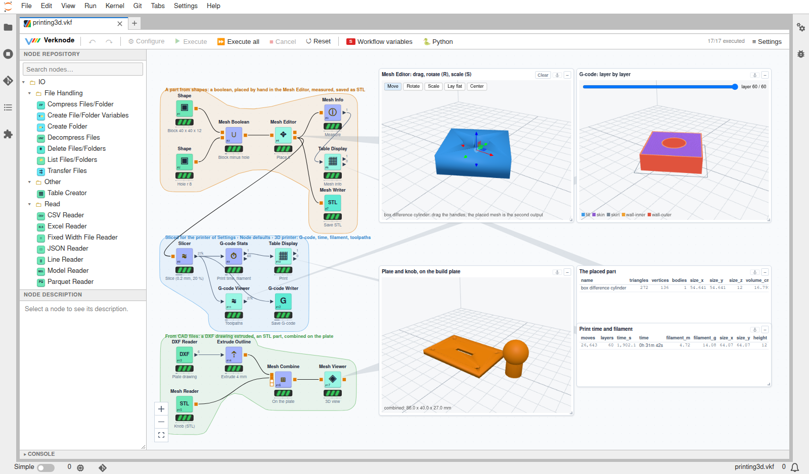

# Packages

A verknode **package** is a set of nodes distributed on its own, as an ordinary Python package. A package
can bring:
- nodes;
- port types;
- canvas widgets, editors and views;
- node defaults.

Users pick the packages they want, and anyone can publish one. The first is
[verknode-printing3d](https://github.com/verknode-project/verknode-printing3d): meshes, CAD files, a
slicer, G-code, and 3D viewers and editors.

Packages so far:

| Package | What it adds |
|---|---|
| [3D Printing](https://github.com/verknode-project/verknode-printing3d) (`printing3d`) | Meshes and CAD files (STL, OBJ, PLY, 3MF, GLB, STEP, IGES, DXF), modelling, a slicer, G-code, 3D viewers and an editor |

## Using packages

**≡ Settings › Packages** is the package manager:
- **Installed:** each package with its version, its status and its number of nodes. Packages with a
  newer version show *Update to …*; *Update all* updates them all. Packages verknode installed also
  show *Uninstall*.
- **Available:** the packages of the index, each with the newest version that fits this verknode, and
  *Install*.
- **Install from anywhere:** a pip requirement, such as `name @ git+https://github.com/…`, a wheel URL
  or a folder.
- **Without a restart:** a package's nodes are in the Node Repository as soon as it is installed. Open
  workflows switch to them. Uninstalled nodes turn into placeholders that name the package to install.
- **Examples:** a package with example workflows has an *Examples* button. It copies them, with their
  data, into `verknode-examples/<package>/` at the top of the file browser and opens the first one.
  Files already there are kept, so your changes to them stay.

Where packages go:
- **Their own Python environment,** in `~/.verknode/packages` ([your verknode
  folder](install.md#your-verknode-folder)). It sees the Jupyter server's packages, so only what is
  missing is installed, and the server's own packages are never changed.
- **It lasts:** with Docker the environment is in the `verknode-home` volume, so it survives a new
  container. When the server's Python changes, verknode makes the environment again and reinstalls its
  packages by itself.

The same works from a terminal:

    python -m jupyterlab_verknode.packages list | available | install NAME | uninstall NAME | update [NAME]

**Updates** follow **≡ Settings › Node defaults › Packages › Updates**:
- *Notify* (the default): the package manager and the server's log tell of updates.
- *Install compatible updates*: at each start of the Jupyter server, the newest versions that fit this
  verknode are installed by themselves.
- *Off*: nothing.

Workflows say which packages they need. A workflow saved with a package's nodes, opened where the package
is missing, keeps those nodes as placeholders. Each placeholder names the package (*Needs the verknode
package 'printing3d'*), and the nodes come back when it is installed.

## Making a package

    python -m jupyterlab_verknode.packages new my-nodes --author "Your Name"

That makes a project to start from:

    verknode-my-nodes/
      pyproject.toml                 # the entry point, and [tool.verknode] api
      src/verknode_my_nodes/
        __init__.py                  # package = Package(...)
        nodes.py                     # NodeModel subclasses: the nodes
      tests/test_nodes.py
      .github/workflows/             # CI, Compatibility, Release: verknode's reusable workflows

A package is found by its entry point, and describes itself with a `Package`:

    # pyproject.toml
    [project.entry-points."verknode.packages"]
    printing3d = "verknode_printing3d:package"

    [tool.verknode]
    api = ">=1.0,<2"

    # src/verknode_printing3d/__init__.py
    from verknode.package import Package

    package = Package(name="printing3d", title="3D Printing", version=__version__, api=">=1.0,<2",
                      modules=["verknode_printing3d.nodes.io", ...], static="static")

What a package can have:
- **Nodes:** every `NodeModel` subclass in its `modules`. They work as in a [node
  folder](custom-nodes.md), with the same API, `verknode.node`. Give each a stable `factory`, such as
  `printing3d.Slicer`: workflows refer to nodes by it.
- **Port types:** `register_port_type("mesh", "3D mesh", "#e07b00")` gives a square port of that colour.
  Its `PortObject` subclass can draw its own port view and hover inspection with `view_html()`.
- **Canvas widgets and editors:** `InputWidget` and `OutputWidget`, with `control = "html"` or
  `renderer = "html"`. An interactive html display is an editor: its page reads `verknode.value` and
  calls `verknode.setValue(v)`, and `select(obj, s, value)` makes its second output (the Mesh Editor
  places a part this way).
- **Examples:** `examples="examples"` names a folder of example workflows and their data, inside the
  Python package so that the wheel includes it. Settings › Packages › *Examples* copies them into the
  user's workspace (node API 1.1).
- **Static files:** `static="static"` is served at `verknode/packages/<name>/`, open to the views'
  sandboxed frames. Pages refer to these files with `package.static_url("viewer.js")`, which also works
  for ES modules and import maps.
- **Node defaults:** `register_defaults(...)` adds setup that is kept per user, such as the 3D printer's
  build volume ([global defaults](custom-nodes.md#global-defaults)).
- **Dependencies:** the usual `dependencies` of `pyproject.toml`. Do not list verknode itself (it is
  not on PyPI): the API range is what ties a package to verknode.

Check a package as verknode's CI does:

    python -m jupyterlab_verknode.packages validate .

It checks:
- the entry point and the API ranges (`[tool.verknode] api` and the `Package`'s);
- the nodes: each imports, its factory is its own and namespaced, it describes itself as JSON, and its
  `version` and `migrate()` fit together;
- the static folder.

## Versions

- **The node API.** `verknode.node.API_VERSION` (now 1.2) versions everything a package uses:
  `verknode.node`, `verknode.package`, the widget base classes, port objects, node defaults and the
  static files. A minor version only adds. A major version may change or remove something: what is
  deprecated keeps working, with a warning, for a whole major version first, and the changelog says
  what to use instead.
- **A package's range.** A package declares the API versions it works with (`api = ">=1.0,<2"`).
  verknode loads only packages whose range includes its API. A package that does not fit is listed as
  *incompatible*, with the reason, and the index offers each verknode only the versions that fit it.
- **A node's settings.** A node that changes its settings raises its `version` and adds
  `migrate(settings, from_version)`. Workflows save each node's version and package, and a workflow
  saved with an older version migrates its settings when it is opened.
- **A package's version** is its own (`[project] version`). A workflow saved with a package's results
  keeps them only for the same version, and runs the nodes again after an update.

The node API's changes:

| Version | What changed |
|---|---|
| 1.2 | Path fields: `path="save"`, `"folder"` or `"any"`, `extensions=[...]` and `path_base`, for the file chooser |
| 1.1 | `Package.examples`: example workflows, opened from Settings › Packages |
| 1.0 | Packages, `register_port_type`, `PortObject.view_html`, interactive html displays, node `version` and `migrate()`, node defaults |

## Automated updates

The policy is that whatever can be updated by itself is. Everyone does as little as possible by hand:

| What | How it stays up to date |
|---|---|
| A package's checks | Its CI uses verknode's `package-check.yml` (`@main`): the checks change with verknode, and the package's workflow does not. |
| A package and a new node API | Its weekly Compatibility workflow (`package-compat.yml`) checks it against the newest verknode. When a new major API version is out and the checks pass with it, it widens the range (`bump-api`) and opens a pull request. |
| The index | A release, that is, a tag `vX.Y.Z` that the Release workflow (`package-release.yml`) turns into a wheel on a GitHub release, is added to `packages/index.json` by the daily `packages-index.yml`. Its API range comes from the tag's `pyproject.toml`. |
| Installed packages | Updates are offered (*Notify*) or installed at start (*Install compatible updates*), only to versions that fit the installed verknode. |
| The package environment | It is made again, with its packages, when the server's Python changes. |
| Saved workflows | Nodes migrate their own settings (`version`, `migrate()`). Results are kept until a package's version changes. |

## Conventions

These conventions keep packages easy to find, safe to combine and able to update by themselves. They are
what `validate` checks, or warns about. [verknode-printing3d](https://github.com/verknode-project/verknode-printing3d)
follows all of them and makes a good model.

| | Convention | printing3d |
|---|---|---|
| Name | The package name is short: lower case, digits and `_`. The distribution is `verknode-<name>` and the module `verknode_<name>`. The entry point has the package's name. | `printing3d`, `verknode-printing3d`, `verknode_printing3d` |
| Node ids | Every node sets `factory = "<name>.<Node>"`. Never change one: saved workflows refer to nodes by it. To rename a node, change its `name` instead. | `printing3d.Slicer` |
| Repository | Categories start with the field the package is about, then a subfolder per kind of node. | `3D Printing/IO`, `…/Modeling`, `…/Printing`, `…/Views` |
| Settings | Changing a node's settings raises its `version`, and `migrate()` turns older settings into the new ones. Removing a setting is a major change. | (all at version 1) |
| Port types | A type that other packages may produce or read gets a generic name, documented in the package's README so that others can use it. A type only the package itself uses gets the package's name in it (`<name>-thing`). | `mesh`: vertices and faces in mm |
| Data | Tables stay tables where they can: one row per item, so that every verknode node works on them. | G-code is a table of moves |
| Setup | What a user sets once goes in node defaults (`register_defaults("<name>", …)`), not in every node. | the printer: build volume, nozzle, filament |
| Files | Viewers' scripts and libraries go in `static/` and load through `package.static_url()`, never from a CDN, so that they work in closed networks. | `static/three/`, `static/viewer.js` |
| Examples | At least one example workflow in `examples/` inside the Python package, built by a script (`scripts/build_example.py`) with the version being released, so that it opens with its results. | `examples/printing3d.vkf` |
| Dependencies | List everything the nodes import, and test in a clean environment: the CI does this. Optional heavy libraries may be imported inside a node, with `requires = [...]`, so that only that node is dimmed when they are missing. | trimesh, shapely, manifold3d, cascadio... |
| Versions | `[project] version` is semver for the package's own nodes. `[tool.verknode] api` and the `Package`'s `api` give the node API range, and the two must match. A release is a tag `v<version>`. | `0.1.3`, `api = ">=1.2,<2"` |
| Automation | Use verknode's workflows: `package-check.yml` for CI, `package-compat.yml` every week, `package-release.yml` on tags. Do not copy them: reference them with `@main`. | `.github/workflows/` |
| Docs | The README opens with a hero screenshot of the example, then a table of the nodes, how to install the package, and its versions. A CHANGELOG lists every release. | `README.md`, `CHANGELOG.md` |
| License | An OSI license. Bundled third-party files keep theirs, next to them. | Apache-2.0; three.js MIT |
| Discovery | The GitHub repository has the topic `verknode-package`. | [topic: verknode-package](https://github.com/topics/verknode-package) |

## Listing a package in the index

1. Release it: push a tag `vX.Y.Z` matching `[project] version`, with the Release workflow in place.
2. Open a pull request on verknode that adds an entry to `packages/index.json`: name, dist, title,
   description, homepage, repository, and `"versions": []`.

From then on, its releases appear in the index by themselves. Other indexes (a company's own, a file)
are set in **≡ Settings › Node defaults › Packages › Package indexes**.
