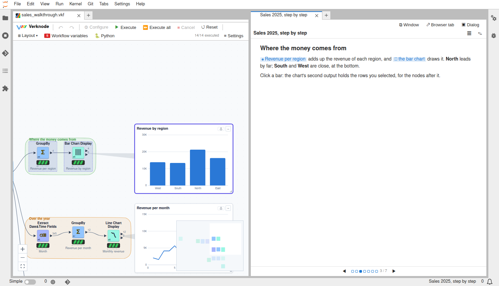

# Walkthroughs: documents that explain a workflow

A **Walkthrough** node holds a document that explains its workflow, read a
section at a time like a slide show. Its links point at the parts of the
workflow: clicking one shows a node or a group on the canvas, opens a node's
settings at one setting, shows a canvas widget, or opens an output table or a
view. Buttons in the text run part or all of the workflow. Stepping to a
section shows what it is about.



The example is `notebooks/examples/walkthroughs/sales_walkthrough.vkf`: a
year of sales lines, cleaned, summed per region and per month, the best
sellers picked with a slider, and a report written. Its walkthrough uses
every kind of reference.

## Reading

The document shows in several places, and they step together:
- **On the canvas,** as the node's widget. ◀ ▶ (or the arrow keys, Space,
  Home and End, with the widget focused) step through the sections, and ☰
  lists them.
- **As a page of its own:** ⇱ on the widget opens it in a JupyterLab tab
  beside the editor (or a browser window outside JupyterLab). From there, it
  moves to a browser window, a browser tab or a dialog like the other views.

Each kind of reference has its own mark:
- **A node** (● and its label): click it to select the node and bring it
  into view. Hover it to see its output data.
- **A group** (▢): shows the group's nodes.
- **Settings** (⚙): opens the node's settings, at the setting the link
  names, which flashes.
- **A widget** (◫): shows the node's canvas widget, restored if it was
  minimized.
- **An output** (▤) or **a view** (⧉): opens it where views open.
- **A run button** (▶): runs the nodes, a group or the whole workflow.
- **A reference to something that is not there** is struck through, and the
  widget says how many there are.

Shown on the canvas, the walkthrough stays in view next to what it points at.

## Writing

The document is Markdown. ✎ on the widget edits it in place. In a tab, the
section at the cursor shows beside the text. Ctrl+S saves, Ctrl+Enter saves
and closes, and Esc closes without saving. The node's settings have the same
document.

| You write | It does |
|---|---|
| `# Title` (at the top) | the title |
| `## A section` | starts a section; text before the first one is the opening section |
| `[text](vk:node/3)` | node #3 |
| `[text](vk:group/1)` | group 1 |
| `[text](vk:settings/3)`, `[text](vk:settings/3/path)` | node #3's settings, at the setting `path` |
| `[text](vk:widget/7)` | node #7's canvas widget |
| `[text](vk:output/5)`, `[text](vk:output/5/2)` | node #5's output 1, or output 2 |
| `[text](vk:view/8)` | node #8's view |
| `[text](vk:run/3)`, `vk:run/3,5`, `vk:run/group/1`, `vk:run/all` | a button that runs node #3 (with what it needs), several nodes, a group, everything |
| `<!-- show: group/1, widget/7 -->` | what a section shows when you step to it (node/, group/, settings/, widget/, output/, view/) |
| `#3` | a node, as in the agents' chats |

Links to files next to the workflow (`[the data](data/sales.csv)`) open them
in JupyterLab. Images, tables, lists, quotes, code and ` ```mermaid `
diagrams work as in the rest of the editor. A reference written as code
(`` `vk:node/3` ``) is an example, not a link.

**Insert ▾** in the editor adds references for you. For each node selected
on the canvas it offers the node, its settings, its widget, its output, its
view, a run button, or a show line. It also lists the groups and the other
nodes.

When the node runs, it checks its references. The ones that point at nothing
become a warning on the node.

## Drafting with an LLM

An empty walkthrough is drafted when the node runs ("Draft it with the LLM
when it is empty", on by default). The model gets the workflow: its nodes,
settings, output columns, groups and widgets. It writes a document in the
format above, which is checked, and its wrong references go back to it once
to be fixed. ✨ Draft with the LLM on the widget replaces the document with a
new draft, after asking.

The model is the node's LLM port (an [LLM connector](llm.md#model-connections-the-llm-port)
node: Ollama, an inference server, a commercial API, Claude or a local
GGUF model) or its Model settings, like the other LLM nodes. "What to
explain, for whom" steers the draft.

Read a draft before you share it. A small local model can link the right
words to the wrong node.

## For agents

Over [MCP](agents.md), two tools let other agents write walkthroughs:
- `get_walkthrough`: the document and its broken references. When there is
  none, it gives the format and the workflow's ids.
- `write_walkthrough`: writes it into a Walkthrough node, a new one or the
  given one. A document with references to nothing is refused, and nothing is
  written.

The workflow agent in the canvas chat can add a Walkthrough node as well:
the format is in the node's description, which it reads with
`node_type_help`.

Exports leave walkthroughs out: they are read in the editor.
