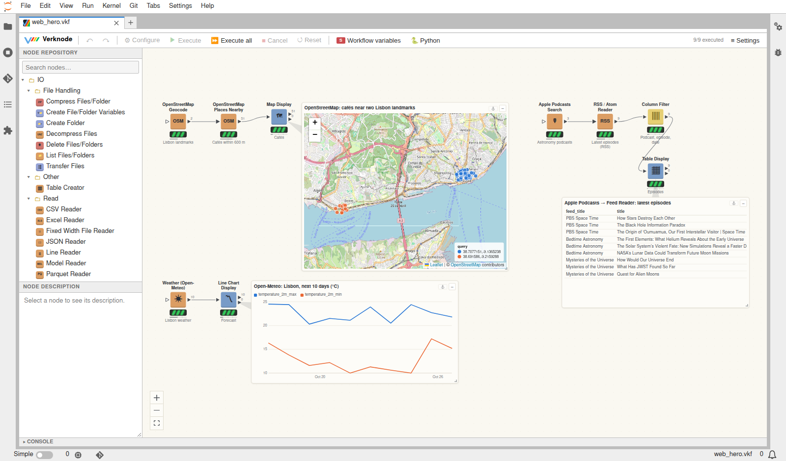
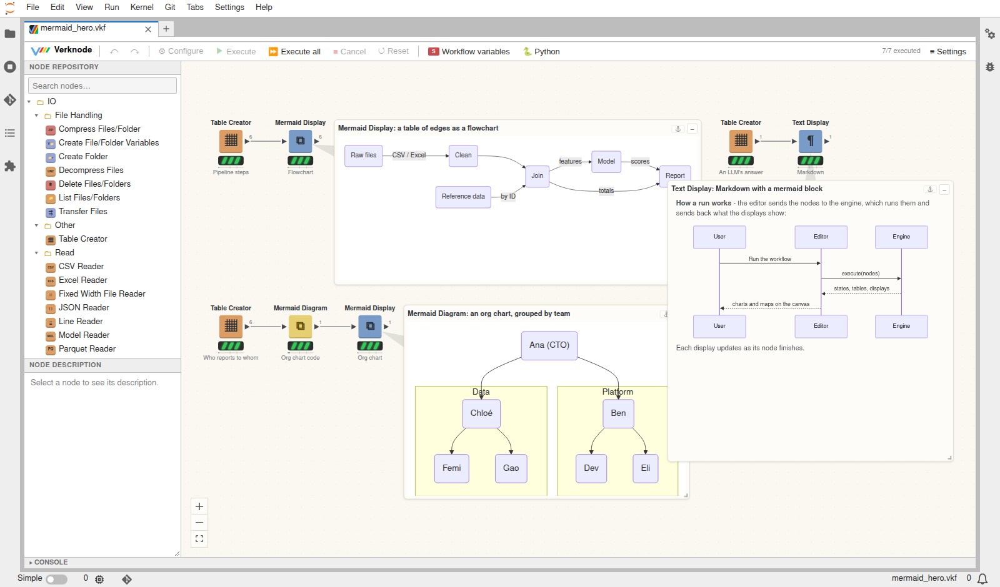

# Web services, GIS and diagrams

Nodes that ask web services, work with places, and draw diagrams. They all
run on the core install: the web nodes use Python's standard library for
HTTP (the requests package, if it is there, for HTTP Request), the GIS nodes
use polars and numpy, and the diagrams and maps are drawn in the browser
(Mermaid, Leaflet).

Examples: `web_services.vkf`, `life_science_web.vkf`, `gis.vkf`,
`mermaid.vkf` in `notebooks/examples`.

## Use cases

**Enrich a table from the web.** Connect a table to a web node and pick a
column: one request per row, with the query in front of each answer, so a
Joiner puts the answers back on the rows. For example:
- company or city names → Wikipedia summaries and coordinates;
- addresses → OpenStreetMap Geocode → Weather, for each site's forecast;
- an internal API → curl, with `$column$` in the URL and a token from an
  environment variable.

**Look for places and plan by distance.** Geocode the sites, find what is
around them (OpenStreetMap Places Nearby: cafés, pharmacies, charging
stations), assign customers to territories (Point in Polygon), keep those
within reach (Geo Filter), or match each one to its nearest depot (Nearest
Point). Map Display shows the result. Shift-drag a box on the map to pass
those rows on, to a table, a report or the next step.


**Follow sources over time.** Feed Reader reads RSS / Atom feeds, and Apple
Podcasts finds podcasts and their feeds. PubMed finds the newest papers on a
topic, and HTTP Request reads any JSON API. Run the workflow every hour with
an Every Interval Loop, keep the items not seen before (Reference Row
Filter against the saved ones), and have an LLM Summarizer write
the digest.



**Life-science lookups without leaving the workflow.** A few examples:
- gene symbols → Ensembl (location, UniProt accessions) → UCSC tracks in
  their regions and their Gene Ontology annotations;
- compound names → ChEMBL (structures and properties) → the RDKit nodes →
  bioactivities;
- a PDB search → structure files → the protein in 3D on the canvas.

Each step is a node, so the whole lookup can be rerun, for other genes or
other compounds.


**Explain with diagrams.** Draw a table of dependencies as a flowchart: steps
of a process, a lineage, who reports to whom, a state machine. Let an LLM
answer with a Mermaid diagram, which a chat or Text Display draws. Write the
code to a Markdown report with Mermaid Diagram.



## Web services

Every web node takes its queries one of two ways:
- from a setting, one per line;
- from a column of the table on its input port, one request per row.

The answers have the query in front, so they can be joined back. The editor
never calls a service while you configure a node; only running it does.
For the same reason, the output columns of most web nodes are known only
after a run.

**HTTP** (Web Services/HTTP)
- **curl** - a curl command as you would type it: `-X`, `-H`, `-d` /
  `--data-raw` / `--json`, `-u`, `-G`, `-A` (redirects are always
  followed). `$column$` and
  `$${Sname}$$` fill in values of the row and flow variables, so the same
  command runs once per row.
- **HTTP Request** - method, URL, query parameters, headers and a body (JSON,
  form or text), like `requests.request(...)`. A bearer token can come from
  an environment variable.

Both turn JSON answers into tables (nested objects as `a.b` columns; a
records path picks the list inside, e.g. `items`), else give the text. A
status of 400 or more fails the node, unless *Keep error answers as rows* is
on. These two nodes can call any URL, POST and DELETE included, so the
workflow agent's sandbox does not run them in its test runs.

**Knowledge** (Web Services/Knowledge)
- **Wikipedia** - summaries (with coordinates, for Map Display), search, or
  the text of pages, in any language edition.
- **PubMed** - articles for a search (NCBI E-utilities): title, journal,
  date, authors, DOI and, if wanted, the abstract. An `NCBI_API_KEY`
  environment variable allows more requests a second.
- **Feed Reader (RSS / Atom)** - the items of RSS 2.0, RSS 1.0 and Atom
  feeds, with podcast enclosures and durations.

**Maps and weather** (Web Services/Maps & Weather)
- **OpenStreetMap Geocode** - places for addresses or names, or addresses
  for coordinates (Nominatim). At most one request a second, as its usage
  policy asks.
- **OpenStreetMap Places Nearby** - OpenStreetMap features with a tag
  (`amenity=cafe`, `shop`, `tourism=museum`) around points, or your own
  Overpass QL query. All points go in one query. The public Overpass servers
  are busy at times: expect up to a minute, and an occasional time-out.
- **Weather (Open-Meteo)** - daily or hourly forecasts (and past days) for
  latitude / longitude columns or place names. No key is needed.
- **Google Maps** - geocoding, place search and distances, with your API key
  in the environment variable `GOOGLE_MAPS_API_KEY` (Google bills the
  requests). Without a key, use OpenStreetMap Geocode.

**Media** (Web Services/Media)
- **Apple Podcasts** - podcasts for a search term (the iTunes Search API),
  with their feed URL. Connect it to a Feed Reader to get the episodes.

**Life science** (Web Services/Life Science)
- **ChEMBL** - molecules by ChEMBL ID or name (SMILES, formula, weight,
  ALogP, H-bond donors / acceptors, clinical phase); similar molecules for a
  SMILES; the bioactivities of molecules; targets by name.
- **Protein Data Bank (RCSB)** - entry facts (title, method, resolution,
  ligands, organisms, DOI), full-text search, and structure files (PDB,
  mmCIF, BinaryCIF) downloaded into a folder, with a path column, for the
  NGL / Mol* structure nodes.
- **UCSC Genome Browser** - the DNA of regions, or the items of a track
  (`knownGene`, `cpgIslandExt`, ...) in them. Regions are `chr:start-end`
  lines or chromosome / start / end columns, of any assembly (`hg38`,
  `mm39`, ...).
- **Ensembl** - genes by symbol or Ensembl ID (location, biotype,
  description, canonical transcript); their sequences (genomic, cDNA, CDS,
  protein); cross references, of the gene or, for one database such as
  `Uniprot/SWISSPROT`, of its transcripts and proteins too.
- **Gene Ontology** - GO terms by ID, term search, and the GO annotations of
  gene products, by UniProt accession (QuickGO).

**Being polite to the services.** Requests carry a User-Agent that names
verknode. Services with a rate limit (Nominatim, NCBI, Ensembl, Overpass,
UCSC) are paced to it, and answers of 429 or 5xx are retried. Error messages
are the service's own. Check each service's terms before running large
batches.

## GIS

In the GIS category, in plain Python, without GDAL or other geo packages.
Points are latitude / longitude columns (WGS 84, degrees). Other shapes are
GeoJSON geometries as text, in a `geometry` column.

- **GeoJSON Reader** - features from a file or URL: their properties as
  columns, `geometry_type`, the geometry, and `lat` / `lon` of its centre
  (the centroid, for polygons).
- **GeoJSON Writer** - a FeatureCollection, with the geometry from the
  geometry column or a point from the latitude / longitude columns.
- **Geo Distance** - the great-circle distance (haversine) of each row to a
  point, or between two coordinate pairs, in km, m, miles or nautical miles;
  the bearing if wanted.
- **Geo Filter** - rows within a radius of a point, in a bounding box, or
  inside a polygon (GeoJSON, or `lat, lon` lines). The second port gets
  the rest.
- **Point in Polygon** - a spatial join: each point gets the columns of the
  polygon it lies in (holes count). The second port counts the points per
  polygon.
- **Nearest Point** - for each row, the nearest row (or k nearest rows) of a
  second table, with the distance, within a maximum if one is set.

**Map Display** (Widgets) shows the rows on an OpenStreetMap map on the
canvas:
- dots at their coordinates, coloured by a column (up to 8 colours) and
  sized by a number;
- GeoJSON shapes;
- a tooltip with the row's values.

Pan and zoom the map. Click a dot or shape to select its row; Ctrl adds or
removes one, and Shift-drag selects the dots in a box. The selected rows go
to the second port. The map tiles are loaded by the browser, from
OpenStreetMap, OpenTopoMap, or a tile URL of your own.

## Diagrams (Mermaid)

[Mermaid](https://mermaid.js.org) turns text into diagrams: flowcharts,
sequence, state and class diagrams, Gantt charts, pies, timelines, mind
maps, and more.

- **Mermaid Display** (Widgets) draws Mermaid on the canvas. It takes the
  code of a text column, from the first row or one diagram per row, or it
  draws the rows of a table as a flowchart (from, to, label).
- **Mermaid Diagram** (Views/Diagrams) writes the code from a table: a
  flowchart of edges, with the to nodes grouped into boxes by a column, a
  pie, or a timeline. Its output is one row with the code, for Mermaid
  Display, a Markdown file or an LLM prompt.
- **Markdown** - Text Display and the chats (LLM Chat, Data Q&A Chat,
  workflow agent) draw ```` ```mermaid ```` code blocks. Ask a model for a
  Mermaid diagram and it appears in the answer.

Diagrams follow the light or dark theme. Mermaid runs with its strict
security level: no scripts or HTML of the code run.
